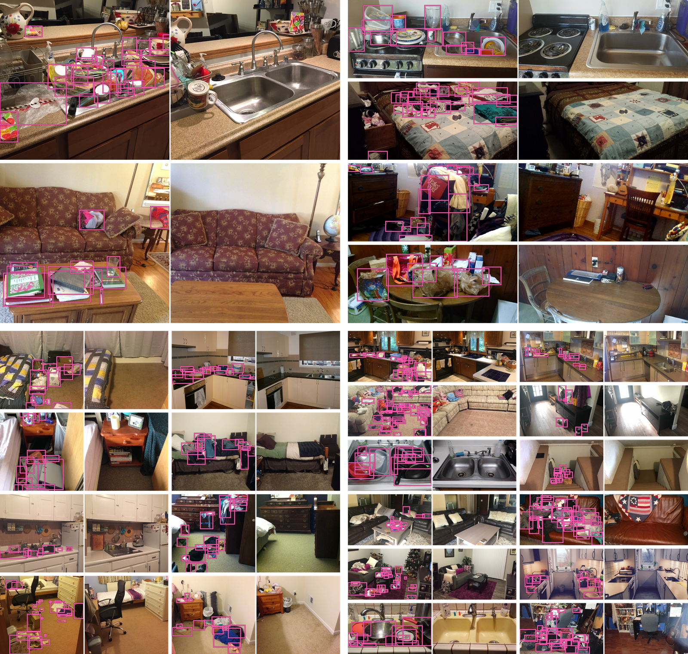

# RoomBench

Before/after room photo pairs with bounding boxes for clutter.

[](assets/RoomBench_showcase.png)

4,193 pairs. Splits: train 3,298, validation 659, test 236.

## Folders

- [`images/`](https://docs.google.com/forms/d/e/1FAIpQLSdn11LuhjMuIFzseDl07x9ZBP5-7kW92fSHBrlhxSAWyoZ75Q/viewform): two JPEG images per pair, `{pair_id}_messy.jpg` (before) and `{pair_id}_clean.jpg` (after).
- `annotations/`: clutter boxes, one file per annotated image, `{pair_id}_messy.json`. Every pair has one. 34 pairs also have `{pair_id}_clean.json`. An empty `annotations` list means the image was checked and has no clutter.
- `source_metadata/`: one file per pair, `{pair_id}.json`, with the pair's source information.
- `splits/`: `train.json`, `validation.json`, `test.json`.
- `assets/`: README figure (`RoomBench_showcase.png` full resolution, `RoomBench_showcase_1600.png` for display).

A `pair_id` has the form `{base}_{n}`. Pairs from the same source post share a `base`, and every pair sharing a `base` is in the same split.

## JSON structures

### annotations/{pair_id}_{messy|clean}.json

```json
{
  "image_file": "03c9LdaU4dYz_0_messy.jpg",
  "image_size": {"width": 3024, "height": 3180},
  "annotations": [
    {
      "id": 14913,
      "image_id": 798,
      "category_id": 1,
      "bbox": [125, 980, 352.5, 777.5],
      "area": 274068.75,
      "segmentation": [],
      "iscrowd": 0
    }
  ]
}
```

- `bbox`: `[x, y, width, height]` in pixels of the full-resolution image, origin top-left. Values may be fractional.
- `area`: `width * height` of the box.
- `category_id`: always `1` (clutter).
- `id`: unique for every box in the dataset.
- `image_id`: the image's numeric ID. A few original images share an `image_id`, so identify images by `image_file`.
- `segmentation` is always empty and `iscrowd` is always `0`; both are kept for COCO compatibility.

### source_metadata/{pair_id}.json

```json
{
  "project_id": "03c9LdaU4dYz_0",
  "reddit_post_id": "t3_ufg1wq",
  "images": [
    {"filename": "03c9LdaU4dYz_0_messy.jpg", "type": "messy"},
    {"filename": "03c9LdaU4dYz_0_clean.jpg", "type": "clean"}
  ],
  "author": "tippytop1522",
  "permalink": "https://old.reddit.com/r/ICleanedMyRoom/comments/ufg1wq/cleaned_the_shared_fridge/",
  "source_url": "https://www.reddit.com/gallery/ufg1wq",
  "submission_time": "2022-04-30T17:41:13+00:00"
}
```

- `project_id`: the pair ID.
- `images[].type`: `messy` (before) or `clean` (after).
- `reddit_post_id`, `submission_time`: Reddit posts only; `null` for other sources.
- `author`, `permalink`: the original poster and the post URL. Either may be `null` if unknown.
- `source_url`: the original image or gallery URL.

### splits/{train|validation|test}.json

A JSON list of messy image filenames, one per pair:

```json
["HZpuqwGg9IlU_0_messy.jpg", "9MeM7hf8XayS_0_messy.jpg"]
```

## Removal

[Removal request form](https://docs.google.com/forms/d/e/1FAIpQLSd87XUbn5GDJTUg1inrnYoj3CKDOqFnI_FQY9uH4mVIBG6ZlQ/viewform)
